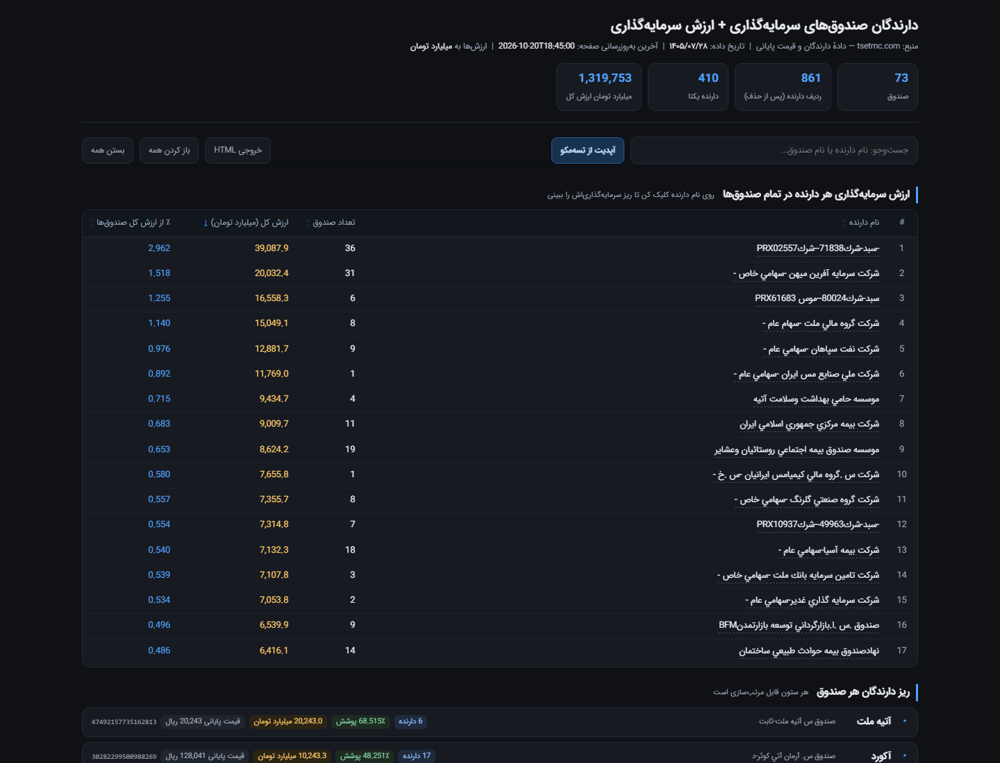
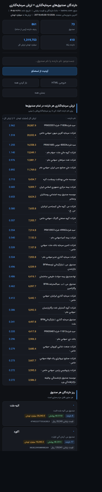

# دارندگان صندوق‌های سرمایه‌گذاری (تسه‌مکو) + ارزش سرمایه‌گذاری

گزارش تعاملی از **دارندگان ۷۳ صندوق سرمایه‌گذاری قابل معامله (ETF) با درآمد ثابت** بر پایه داده رسمی [tsetmc.com](https://tsetmc.com)، همراه با ارزش ریالی سبد هر دارنده.



## فایل‌ها

| فایل | توضیح |
|---|---|
| `tsetmc-fund-holders.html` | گزارش تک‌فایلی تعاملی (فونت IRANSans جاسازی‌شده، بدون نیاز به اینترنت برای دیدن داده) |
| `tsetmc-fund-holders.xlsx` | اکسل ۴ شیتی: خلاصه صندوق‌ها / دارندگان تجمیعی / جزئیات / یادداشت |
| `tsetmc-fund-holders.csv` | همان جزئیات به‌صورت CSV (UTF-8 با BOM برای اکسل فارسی) |
| `fetch_tsetmc.py` | دریافت داده خام از API رسمی → `data.json` + `holders.csv` |
| `build_html.py` | ساخت گزارش HTML از `data.json` + `template.html` |
| `template.html` | قالب گزارش (CSS/JS کامل، جای‌نگهدار داده و فونت) |
| `assets/` | فونت IRANSans (subset woff2) و تصاویر |

## قابلیت‌ها

- **جدول تجمیعی**: ارزش سرمایه‌گذاری هر دارنده در تمام صندوق‌ها، سهم درصدی از ارزش کل.
- **ریز هر صندوق**: دارندگان هر صندوق با درصد و ارزش؛ همه ستون‌ها سورت‌پذیر.
- **مودال دارنده**: کلیک روی نام هر دارنده → ریز سرمایه‌گذاری‌اش در همه صندوق‌ها + جمع کل.
- **جست‌وجوی زنده** روی نام دارنده و نام صندوق.
- **دکمه «آپدیت از تسه‌مکو»**: داده را بدون بازسازی فایل، زنده از API می‌گیرد و در `localStorage` همان مرورگر کش می‌کند (۷۳ صندوق × ۳ درخواست، ۶ همزمان).
- **افزودن صندوق با کد نماد**: کد نماد (insCode) هر نماد دلخواه را در فیلد نوار ابزار وارد کنید تا همان لحظه از تسه‌مکو گرفته و به گزارش اضافه شود (Enter هم کار می‌کند). صندوق‌های افزوده‌شده در `localStorage` می‌مانند و با دکمه «حذف» روی کارت‌شان پاک می‌شوند.
- **دکمه «خروجی HTML»**: از وضعیت فعلی (بعد از آپدیت) یک فایل HTML مستقل و آفلاین می‌سازد.
- **موبایل**: چیدمان واکنش‌گرا (KPI دوستونه، دکمه‌های تمام‌عرض، جدول‌های ۳ ستونی برای عرض ۳۹۰px).



## منبع داده

| داده | اندپوینت |
|---|---|
| فهرست دارندگان | `https://cdn.tsetmc.com/api/Shareholder/GetInstrumentShareHolderLast/{insCode}` |
| قیمت پایانی | `https://cdn.tsetmc.com/api/ClosingPrice/GetClosingPriceInfo/{insCode}` |
| اطلاعات نماد (تعداد کل واحد) | `https://cdn.tsetmc.com/api/Instrument/GetInstrumentInfo/{insCode}` |
| جست‌وجوی نماد | `https://cdn.tsetmc.com/api/Instrument/GetInstrumentSearch/{name}` |

**ارزش هر دارنده** = تعداد واحد × قیمت پایانی (ریال) ÷ ۱۰^۱۰ → **میلیارد تومان**.
ارزش کل ۷۳ صندوق: **۱٬۳۱۹٬۷۵۳ میلیارد تومان** (داده ۱۴۰۵/۰۷/۲۸).

## ساخت مجدد

```bash
pip install requests
python fetch_tsetmc.py       # data.json + holders.csv
python build_html.py         # tsetmc-fund-holders.html
```

برای تست سریع: `python fetch_tsetmc.py --limit 3`.

## نکته‌ها و محدودیت‌ها

- تسه‌مکو فقط دارندگان بالای آستانه (معمولاً ≥۱٪) را منتشر می‌کند؛ بنابراین جمع درصدهای هر صندوق به ۱۰۰ نمی‌رسد و باقی در ردیف «شخص حقيقي» است.
- ردیف‌های `شخص حقيقي` و `ETFكدرزروصندوقهاي سرمايه گذاري قابل معامله` از فهرست و از محاسبات ارزش حذف شده‌اند (در همه صندوق‌ها تکرار می‌شوند و ارزش واقعی سبد نیستند).
- نام برخی نهادها در تسه‌مکو ناشناس/مخفف است (`PRXسبد-شرك…`، `ذذذبازارگردان…`)؛ عیناً همان‌طور که منتشر شده نمایش داده می‌شود.
- سه صندوق (لبخند، افران، همای) داده کامل ندارند و فقط ۲–۳ دارنده برایشان منتشر شده است.
- «هامز» در تسه‌مکو «هام‌رز» است.
- قیمت‌ها قیمت پایانی آخرین روز معاملات است، نه قیمت لحظه‌ای.

## سلب مسئولیت

این گزارش صرفاً بازنشر داده عمومی تسه‌مکو است و توصیه سرمایه‌گذاری نیست.
